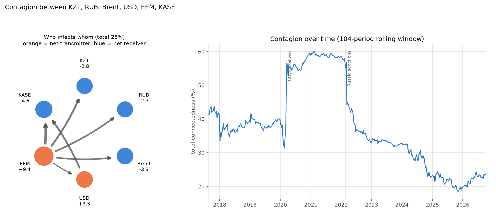

# Tenge Contagion

[](https://github.com/aidaman01/tenge-contagion/actions/workflows/tests.yml)
[](LICENSE)


**How much of the Kazakh tenge's movement is imported, and from where?** This project measures how shocks spread
between the tenge, the ruble, oil, the US dollar, emerging-market equities and the Kazakhstan stock market, using the
Diebold-Yilmaz connectedness network on official data (National Bank of Kazakhstan, Bank of Russia, Federal Reserve,
EIA, KASE).

| | |
|---|---|
| **Answer** | About **30%** of the tenge's weekly forecast variance comes from other markets, 70% is its own. The **ruble** is the largest outside source (13.9%), then EM equities (6.1%), the US dollar (5.8%) and oil (4.0%). |
| **Surprise** | The ruble moves *with* the tenge but does not lead it (pairwise net −0.0), and oil matters little at weekly frequency. |
| **Crises** | Contagion jumped with COVID (35% → 57%) and with the 2022 sanctions (39% → about 50% for months, 52-week window). |
| **Caveat** | Connectedness is shared forecast uncertainty, not causality. |



## Kazakhstan result: how much of the tenge's movement is imported?

Weekly returns, 2015-08-28 to 2026-10-09 (575 weeks, tenge free float), six markets: USD/KZT (National Bank of
Kazakhstan), USD/RUB (Bank of Russia), Brent, the broad US dollar index, emerging-market equities (EEM) and the
KASE index. VAR lag 1 (BIC), 10-week horizon, rolling window 104 weeks.

**Where the variance of the tenge's 10-week forecast comes from:**

| Source | Share of USD/KZT variance | Pairwise net into KZT |
|---|---|---|
| USD/KZT itself | **69.5%** | |
| Ruble | **13.9%** | −0.0 |
| EM equities (EEM) | 6.1% | +2.1 |
| US dollar index | 5.8% | +0.9 |
| Brent | 4.0% | −0.7 |
| KASE index | 0.7% | +0.6 |

About **30%** of the tenge's forecast variance is imported; 70% is its own.

| Market | Received from others | Transmitted to others | Net |
|---|---|---|---|
| USD/KZT | 30.5% | 27.7% | −2.8 |
| USD/RUB | 26.5% | 24.3% | −2.3 |
| Brent | 12.3% | 9.0% | −3.3 |
| US dollar index | 39.6% | 43.1% | +3.5 |
| EM equities (EEM) | 42.0% | 51.4% | **+9.4** |
| KASE index | 15.5% | 10.9% | −4.6 |

Total connectedness: **27.7%**.

- **The ruble is the largest outside source, but it does not lead the tenge.** It accounts for 13.9% of the tenge's
  variance, yet the pairwise net is −0.0: the link is same-week co-movement (correlation 0.44), which the generalized
  decomposition splits equally between the two. At weekly frequency there is no sign of the ruble moving first.
- **Oil matters little in weekly returns: 4.0%,** with a slightly negative pairwise net (−0.7). This is weaker than the
  usual "oil currency" story.
- **The tenge is only a weak net receiver (−2.8), and not consistently.** In the rolling windows its net is negative
  in 47% of them and positive in the rest, from −17.1 (window ending 2017-09-15) to +13.3 (2022-03-25).
- **The main transmitters are global, not regional:** EM equities (+9.4) and the US dollar (+3.5).
- **COVID:** total connectedness went from 35.3% (window before 2020-03-09) to 56.6% (2020-03-20).
- **Sanctions (2022-02-24): the 104-week window cannot isolate them.** Total was already 56.3% before, because that
  window still contained March 2020; it peaked at 56.8% on 2022-03-04 and then fell to 44.5% by 2022-03-25 as the
  COVID weeks left the window. What did change at once is direction: the ruble's net jumped from +10.8 to +64.2
  (2022-03-04), and the tenge's net was positive (+9.2 to +13.3) in March 2022.
- **A 52-week window (grey line) separates the two crises.** COVID: 48.5% before, 71.7% on 2020-03-20. Sanctions:
  38.7% before, then about 50% from March to May 2022 (50.3% on 2022-03-25, 49.3% on 2022-05-06). The single-week
  spike to 78.4% on 2022-03-04 is the window ending on the ruble's +23.6% week; it falls to 53.4% a week later and
  should not be read as the size of the effect. Net values in 52-week windows are too unstable to report.
- Since 2022 contagion has fallen steadily: 18.4% at its lowest (2025-11-07), 23.8% in the last window.

**Robustness, weekly log volatility (568 weeks):** total 25.9%; the tenge gets 73.7% from itself, 15.8% from the
ruble (pairwise net +2.3 into KZT), 3.6% Brent, 3.5% EEM, 2.1% US dollar, 1.2% KASE; KZT net −0.8. The ruble as the
main outside source holds. The roles of the dollar (−9.5, a receiver) and the ruble (+5.1, a transmitter) differ
from the returns result, so those are not robust. Rolling total: 21.6% before COVID, peak 42.1% (2020-09-04);
47.1% before the sanctions date, peak 50.7% (2022-03-11). With a 52-week window: 32.0% before COVID, peak 62.6%
(2020-08-07); 26.5% before the sanctions, peak 50.7% (2022-05-27).

**Why the managed period (before 2015-08-20) is left out.** Under the managed rate USD/KZT did not change on 18.9%
of days, and its typical daily move (robust standard deviation) was 0.067%, against 0.376% after the float. The rate
moved in administered steps (the largest, +16.3% on 2009-02-04, a devaluation). A VAR on that series would measure
the policy schedule, not how market shocks reach the tenge.

**Data handling.** Official rates dated D (National Bank of Kazakhstan, Bank of Russia) are set from trading on the
previous business day; this is visible in the data (the tenge's float jump of 2015-08-20 appears in the rate dated
2015-08-21, the ruble's jump of 2022-02-24 in the rate dated 2022-02-25). Both are moved back to the trading day, so
that a same-day shock is not mistaken for a one-week lag. The National Bank publishes no rate for 2023-07-28 to
2023-08-28, and the Bank of Russia set none for trading days 2026-01-01 to 01-09; those weeks (6 in total) are
left out rather than filled. Prices carry over at most 2 days across holidays.

## Earlier result: oil and commodity currencies, 2000–2026


Weekly returns of Brent crude and five commodity-linked currencies against the US dollar.

| Market | Received from others | Transmitted to others | Net |
|---|---|---|---|
| Brent crude | 26.4% | 17.5% | **−8.9** |
| Norwegian krone | 51.0% | 55.5% | +4.5 |
| Canadian dollar | 52.3% | 58.5% | **+6.2** |
| Mexican peso | 49.8% | 52.1% | +2.3 |
| Brazilian real | 45.3% | 42.1% | −3.2 |
| South African rand | 48.3% | 47.4% | −0.9 |

Total connectedness: **45.5%** of each market's forecast uncertainty comes from the others.

- **Contagion jumped at every crisis and never returned to pre-2008 levels.** About 14–18% in 2003–2004, 66% in 2009–2012, and an instant jump with COVID in March 2020. Markets became far more interconnected after 2008.
- **Oil is a net *receiver*, not the transmitter you'd expect.** Every series here is priced in US dollars, so the dollar itself is the hidden common driver, and the currencies capture it first. Lesson for the Kazakhstan study: include a dollar index, or the dollar's influence gets credited to oil or the ruble.

## Method

Diebold & Yilmaz (2012), the standard measure of financial contagion:

1. **VAR(p):** each market's weekly return depends on last week's returns of all markets. Lag p chosen by BIC.
2. **Generalized forecast-error variance decomposition** (Pesaran & Shin 1998): `θ[i, j]` is the share of market i's 10-week forecast uncertainty caused by shocks starting in market j. Unlike the usual Cholesky decomposition, it does not depend on the order of the variables.
3. **Network measures:**
   - **total:** average share coming from other markets (0–100%);
   - **from others, to others, net:** who receives and who transmits;
   - **pairwise net:** arrows in the network.
4. **Rolling window** (104 weeks; 52 weeks as a check) to watch contagion change through time.

## Validation

`python tests/test_contagion.py` (or `python -m pytest`): 11 tests, about 2 seconds. Each checks a known answer.

| Check | Result |
|---|---|
| Closed form: no dynamics, correlation ρ ⇒ θ₁₂ = ρ²/(1+ρ²), for equal and unequal variances | exact |
| Moving-average matrices of a VAR(1) are powers of A | exact (1e-15) |
| Generalized FEVD = Cholesky FEVD when shocks are uncorrelated | exact (1e-14) |
| VAR estimation recovers known coefficients and the true lag order | coefficients within 0.02, lag correct |
| **Known network:** oil and ruble feed the tenge, nothing feeds back | net transmitter/receiver and total recovered within 1.5 pts, 3 seeds |
| Accounting: nets sum to 0, total = mean "from" = mean "to" | exact |
| Result does not depend on the order of variables | exact |
| Rolling index at date t uses only data up to t | changing later data leaves earlier values unchanged |
| Real data: total within a plausible range; 2009–2012 contagion > 2003–2006 by 15+ pts | holds |

Two more tests cover the Kazakhstan pipeline: the parsers for each official source and the move to trading dates
(on snippets in each source's format, no network), and the command-line options `--start`, `--focus`, `--measure`, `--compare-window`.

A deliberately broken decomposition (dividing by the wrong variance) is caught by the closed-form test.

## Run

```
pip install -r requirements.txt
python tests/test_contagion.py
python -m contagion                         # bundled oil and currencies
python -m contagion --csv prices.csv        # any wide CSV of daily prices (date + one column per market)

python scripts/fetch_kz.py                  # downloads the Kazakhstan data, prints checks, writes data/kz_prices.csv
python -m contagion --csv data/kz_prices.csv --start 2015-08-20 --focus KZT --compare-window 52 \
    --title "How shocks reach the Kazakh tenge: weekly returns, Aug 2015 to Oct 2026" --out contagion_kz.png
python -m contagion --csv data/kz_prices.csv --start 2015-08-20 --focus KZT --measure logvol
```

## Limits

- **Connectedness is not causality.** It measures how forecast uncertainty is shared. With correlated shocks, the generalized decomposition splits same-day co-movement between both markets.
- **Different closing times:** Brent (EIA spot) and the Fed's noon New York exchange rates are not recorded at the same moment. Weekly returns reduce this, which is why weekly data is the default.
- **Different time zones in the Kazakhstan network:** the tenge and ruble rates come from Almaty and Moscow trading,
  Brent, the dollar index and EEM from London and New York. Weekly data reduces but does not remove this.
- **The generalized decomposition splits same-week co-movement equally,** so a large share with a pairwise net near
  zero (the ruble) means "they move together", not "one drives the other".
- **Results depend on which markets are included:** a missing common driver (here, the dollar) is credited to the markets that move with it.

## Data

Bundled in `data/`, both public domain:
- `brent-daily.csv`: Brent spot price, U.S. Energy Information Administration, via [datasets/oil-prices](https://github.com/datasets/oil-prices).
- `fx-daily.csv`: Federal Reserve H.10 exchange rates, via [datasets/exchange-rates](https://github.com/datasets/exchange-rates).

Kazakhstan network, downloaded by `scripts/fetch_kz.py` into `data/kz_prices.csv`, which is **not committed**
(Yahoo Finance and KASE do not allow redistribution); run the script to rebuild it:
- USD/KZT: official rates of the [National Bank of Kazakhstan](https://nationalbank.kz) (daily report page). No
  licence is stated on the page; not redistributed here.
- USD/RUB: official rates of the [Bank of Russia](https://www.cbr.ru) (`XML_dynamic`, code R01235), under the site's
  user agreement; not redistributed here. The script falls back to http when https is refused from some networks.
- US dollar: Nominal Broad U.S. Dollar Index, Federal Reserve Board H.10 (public domain), via
  [FRED](https://fred.stlouisfed.org/series/DTWEXBGS) (DTWEXBGS), FRED terms of use.
- EM equities: iShares MSCI Emerging Markets ETF (EEM), dividend-adjusted close, Yahoo Finance via `yfinance`;
  Yahoo terms of service, personal use, no redistribution.
- KASE index: [Kazakhstan Stock Exchange](https://kase.kz) archive. KASE: "Copying materials only with written
  permission"; not redistributed here.
- Brent: the bundled EIA file above.

## License

Code: [MIT](LICENSE). Data: each source's own terms, listed above. If you use this work, see
[CITATION.cff](CITATION.cff).

## References

- Diebold, F. & Yilmaz, K. (2012). Better to give than to receive: Predictive directional measurement of volatility spillovers. *International Journal of Forecasting* 28(1).
- Diebold, F. & Yilmaz, K. (2014). On the network topology of variance decompositions. *Journal of Econometrics* 182(1).
- Pesaran, H. & Shin, Y. (1998). Generalized impulse response analysis in linear multivariate models. *Economics Letters* 58(1).
