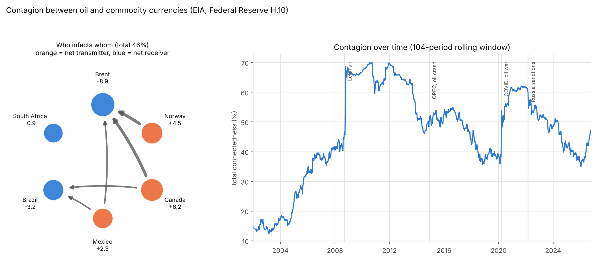

# Tenge Contagion

**How much of the tenge's turbulence is imported, and from where?** Shocks spread between markets the way information spreads through a network. This project measures that network: who transmits shocks, who receives them, and how contagion changes through crises.

> **Status:** engine validated, first real result below (oil and commodity currencies, public-domain data). The Kazakhstan network (USD/KZT, USD/RUB, oil, the US dollar, emerging-market equities) is the next stage.



## First real result: oil and commodity currencies, 2000–2026

Weekly returns of Brent crude and five commodity-linked currencies against the US dollar.

| Market | Received from others | Transmitted to others | Net |
|---|---|---|---|
| Brent crude | 26.4% | 17.5% | **−8.9** |
| Norwegian krone | 51.0% | 55.5% | +4.5 |
| Canadian dollar | 52.3% | 58.5% | **+6.2** |
| Mexican peso | 49.8% | 52.1% | +2.3 |
| Brazilian real | 45.3% | 42.1% | −3.2 |
| South African rand | 48.3% | 47.4% | −0.9 |

Total connectedness: **45.5%** of each market's forecast uncertainty comes from the others.

- **Contagion jumped at every crisis and never returned to pre-2008 levels.** About 14–18% in 2003–2004, 66% in 2009–2012, and an instant jump with COVID in March 2020. Markets became far more interconnected after 2008.
- **Oil is a net *receiver*, not the transmitter you'd expect.** Every series here is priced in US dollars, so the dollar itself is the hidden common driver, and the currencies capture it first. Lesson for the Kazakhstan study: include a dollar index, or the dollar's influence gets credited to oil or the ruble.

## Method

Diebold & Yilmaz (2012), the standard measure of financial contagion:

1. **VAR(p):** each market's weekly return depends on last week's returns of all markets. Lag p chosen by BIC.
2. **Generalized forecast-error variance decomposition** (Pesaran & Shin 1998): `θ[i, j]` is the share of market i's 10-week forecast uncertainty caused by shocks starting in market j. Unlike the usual Cholesky decomposition, it does not depend on the order of the variables.
3. **Network measures:**
   - **total:** average share coming from other markets (0–100%);
   - **from others, to others, net:** who receives and who transmits;
   - **pairwise net:** arrows in the network.
4. **Rolling window** (104 weeks) to watch contagion change through time.

## Validation

`python tests/test_contagion.py` (or `python -m pytest`): 9 tests, about 2 seconds. Each checks a known answer.

| Check | Result |
|---|---|
| Closed form: no dynamics, correlation ρ ⇒ θ₁₂ = ρ²/(1+ρ²), for equal and unequal variances | exact |
| Moving-average matrices of a VAR(1) are powers of A | exact (1e-15) |
| Generalized FEVD = Cholesky FEVD when shocks are uncorrelated | exact (1e-14) |
| VAR estimation recovers known coefficients and the true lag order | coefficients within 0.02, lag correct |
| **Known network:** oil and ruble feed the tenge, nothing feeds back | net transmitter/receiver and total recovered within 1.5 pts, 3 seeds |
| Accounting: nets sum to 0, total = mean "from" = mean "to" | exact |
| Result does not depend on the order of variables | exact |
| Rolling index at date t uses only data up to t | changing later data leaves earlier values unchanged |
| Real data: total within a plausible range; 2009–2012 contagion > 2003–2006 by 15+ pts | holds |

A deliberately broken decomposition (dividing by the wrong variance) is caught by the closed-form test.

## Run

```
pip install -r requirements.txt
python tests/test_contagion.py
python -m contagion                         # bundled oil and currencies
python -m contagion --csv prices.csv        # any wide CSV of daily prices (date + one column per market)
```

## Limits

- **Connectedness is not causality.** It measures how forecast uncertainty is shared. With correlated shocks, the generalized decomposition splits same-day co-movement between both markets.
- **Different closing times:** Brent (EIA spot) and the Fed's noon New York exchange rates are not recorded at the same moment. Weekly returns reduce this, which is why weekly data is the default.
- **Results depend on which markets are included:** a missing common driver (here, the dollar) is credited to the markets that move with it.

## Data

Bundled in `data/`, both public domain:
- `brent-daily.csv`: Brent spot price, U.S. Energy Information Administration, via [datasets/oil-prices](https://github.com/datasets/oil-prices).
- `fx-daily.csv`: Federal Reserve H.10 exchange rates, via [datasets/exchange-rates](https://github.com/datasets/exchange-rates).

## References

- Diebold, F. & Yilmaz, K. (2012). Better to give than to receive: Predictive directional measurement of volatility spillovers. *International Journal of Forecasting* 28(1).
- Diebold, F. & Yilmaz, K. (2014). On the network topology of variance decompositions. *Journal of Econometrics* 182(1).
- Pesaran, H. & Shin, Y. (1998). Generalized impulse response analysis in linear multivariate models. *Economics Letters* 58(1).
